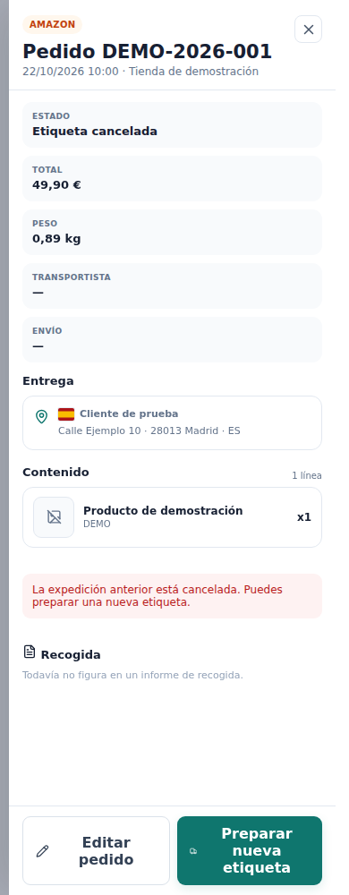

# Reetiquetar tras cancelar — revisión sobre A+B

No publicado. Datos sintéticos; no se crean expediciones ni documentos reales. Base: versión publicada de A+B, commit local 5fdb8fe, aplicación equivalente a main 64a09358.

Se conserva el inventario completo en pedidos pendientes y con etiqueta. Para una expedición cancelada sin etiqueta activa, se sustituye el mensaje de bloqueo por **Editar pedido** y **Preparar nueva etiqueta**, que abre el flujo existente de selección de servicio. No se permite en pedidos cancelados, Amazon pendiente de pago, PII purgada, expedición activa ni envío externo.

| Ancho | Tema | Antes | Después |
|---|---|---|---|
| 390 | light | [Ver](before-cancelled-label-light-390.png) | [Ver](after-cancelled-label-light-390.png) |
| 390 | dark | [Ver](before-cancelled-label-dark-390.png) | [Ver](after-cancelled-label-dark-390.png) |
| 1280 | light | [Ver](before-cancelled-label-light-1280.png) | [Ver](after-cancelled-label-light-1280.png) |
| 1280 | dark | [Ver](before-cancelled-label-dark-1280.png) | [Ver](after-cancelled-label-dark-1280.png) |
| 1440 | light | [Ver](before-cancelled-label-light-1440.png) | [Ver](after-cancelled-label-light-1440.png) |
| 1440 | dark | [Ver](before-cancelled-label-dark-1440.png) | [Ver](after-cancelled-label-dark-1440.png) |

Control sin cambios: [pendiente antes](before-detail-light-390.png) · [pendiente después](after-detail-light-390.png). [Inventario y comprobación de callbacks](manifest.json).

