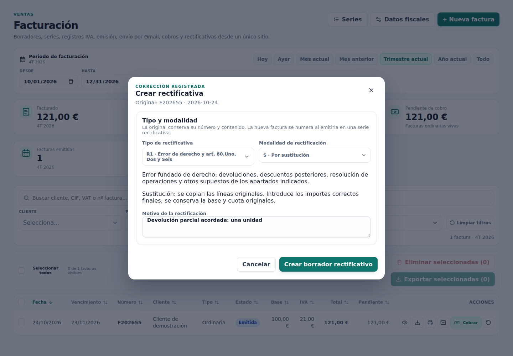
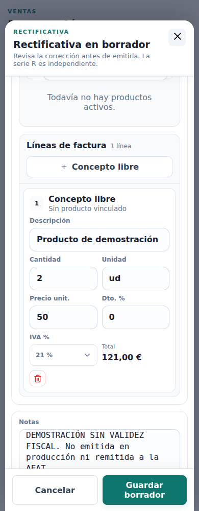
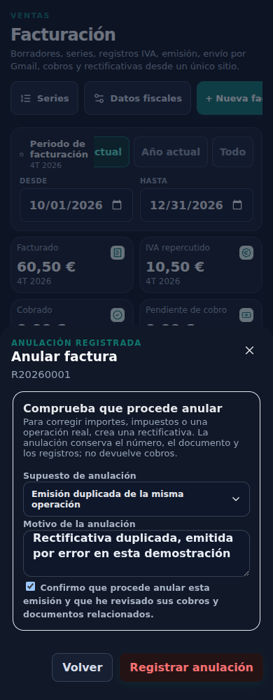

# Circuito de corrección — revisión visual

**Datos sintéticos y componentes React reales; sin producción ni emisión fiscal real.** Los estados emitidos/anulados se preparan en el harness, y las operaciones transaccionales se prueban aparte con SQL en bases desechables. Este paquete no es una captura del navegador del propietario. [Alcance, SQL, corte y activación](README.md).

Selección persistida de las 40 capturas del circuito; el artefacto CI `verifactu-correction-circuit` contiene la serie completa a 1440/390 px y ambos temas. [Mediciones](measurements.json): cero desbordamientos horizontales en el documento; los paneles de acciones y el editor conservan su scroll interno. El generador desplaza el editor hasta las líneas en una segunda captura, sin alterar el CSS de producción. Los colores se capturan con transiciones desactivadas y la confirmación mantiene checked.

| Paso | Captura |
|---|---|
| Antes: detalle sin circuito completo | [Escritorio](screenshots/00-before-correction-detail-1440-light.png) |
| 1. Factura emitida/listado | [Escritorio](screenshots/01-issued-list-1440-light.png) |
| 2. Intento de edición: aviso y acciones disponibles, sin editar/borrar/reabrir | [Escritorio](screenshots/02-immutable-detail-1440-light.png) |
| 3. Clasificar rectificativa R1–R5, S/I y motivo | [Escritorio](screenshots/03-correction-classification-1440-light.png) · [Móvil oscuro](screenshots/03-correction-classification-390-dark.png) |
| 4. Editor con serie R y líneas precargadas | [Escritorio](screenshots/04-correction-editor-1440-light.png) · [Móvil: líneas editables](screenshots/04b-correction-lines-390-light.png) |
| 5. Emitida: original Rectificada y nuevo número de serie R | [Listado](screenshots/05-correction-issued-list-1440-light.png) |
| 6. Vínculo, clasificación y motivo en detalle | [Escritorio](screenshots/06-correction-issued-detail-1440-light.png) · [Móvil](screenshots/06-correction-issued-detail-390-light.png) |
| 7. Anular: supuesto, motivo y confirmación explícita | [Móvil oscuro](screenshots/07-cancellation-confirm-390-dark.png) |
| 8. Estado Anulada, documentos y números conservados | [Listado](screenshots/08-cancelled-list-1440-light.png) |

[PDF rectificativo de demostración, sin validez fiscal](rectificativa-synthetic.pdf). Se inspeccionó renderizado: referencia original F202655/24-10-2026, R1/S, motivo y base/cuota original. Otra prueba genera y renderiza un motivo de 1.000 caracteres con 80 conceptos (4 páginas), comprobando la última línea; no sustituye ni modifica un PDF histórico.

### Clasificación y motivo

### Líneas editables en móvil

### Anulación confirmada en oscuro

