# Fase 2: ajuste final de filtros aprobado

Revisión del propietario del 20-10-2026: publicación autorizada tras corregir filtros de escritorio y verificar CI. Capturas con componentes y CSS reales, datos sintéticos, red bloqueada y locale es-ES. El «antes» corresponde a la revisión cc5562ae, no a producción.

Búsqueda en fila propia, filtros con columnas iguales en una fila, controles de 42 px, texto con elipsis y etiquetas/reset alineados. Gastos mantiene su buscador independiente en su propia fila. Sin cambiar estado, opciones, acciones o cifras.

| Pantalla | Ancho | Antes | Después |
|---|---:|---|---|
| Facturación | 1280 | 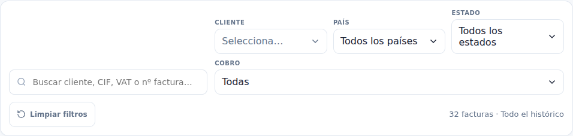 | 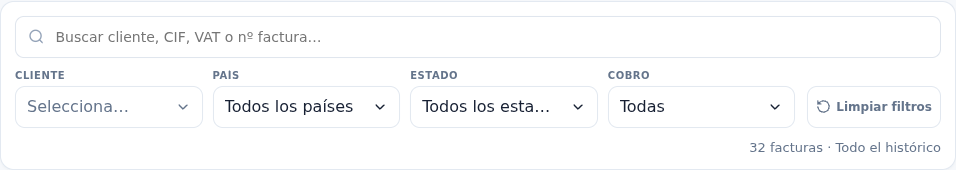 |
| Facturación | 1440 | 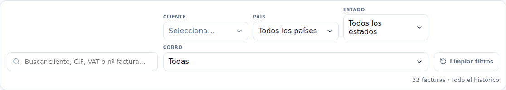 | 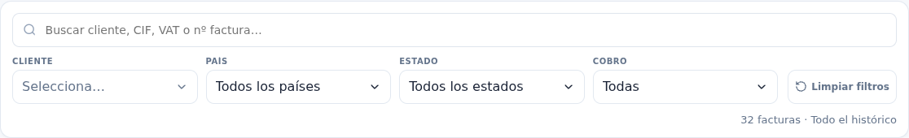 |
| Gastos | 1280 | 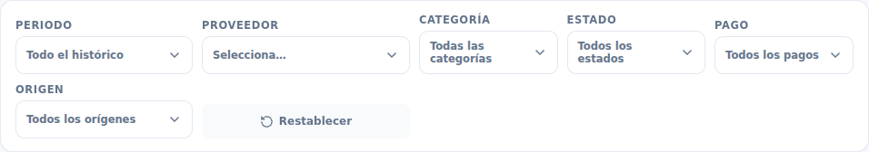 | 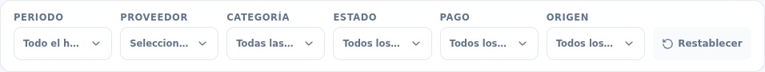 |
| Gastos | 1440 | 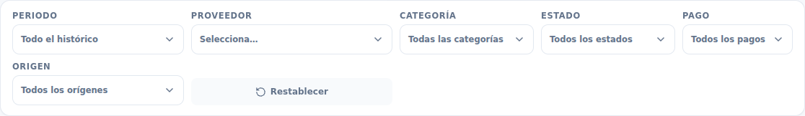 | 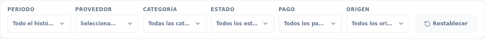 |
| Recibos | 1280 | 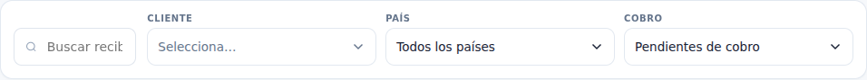 | 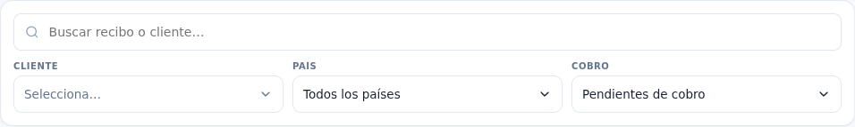 |
| Recibos | 1440 | 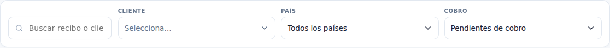 | 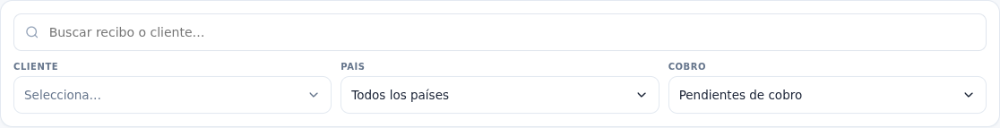 |

## Altura hasta la lista (px)

| Pantalla | Ancho | Revisión anterior | Corregida |
|---|---:|---:|---:|
| billing | 390 | 1348.7 | 1336.7 |
| billing | 1280 | 1133.1 | 1076.1 |
| billing | 1440 | 1087.3 | 1057.3 |
| expenses | 390 | 1557.3 | 1545.3 |
| expenses | 1280 | 1130.3 | 1053.3 |
| expenses | 1440 | 1096.7 | 1025.7 |
| receipts | 390 | 1203.8 | 1187.8 |
| receipts | 1280 | 878.7 | 932.7 |
| receipts | 1440 | 861.9 | 915.9 |

El test geométrico falla en la revisión anterior (saltos de línea/alineación) y pasa en los nueve escenarios corregidos. Comprueba texto con Range.getClientRects, igualdad de anchos, fila única, alturas, reset y búsqueda; mantiene las comprobaciones anteriores de información, selección y acciones. Recibos aumenta 54 px en escritorio para dar fila propia al buscador, manteniendo la lista dentro del primer pantallazo de 1000 px. En móvil las tres siguen bajo 1800 px.
