# Fase 3 · lote 2: Amazon y Shopify — SIN PUBLICAR

Capturas de componentes y CSS reales con datos sintéticos, red bloqueada y locale es-ES. Referencia: lote 1 aprobado, commit 002b953d (mismo árbol que su merge 0d34847a). Viewport 1000 px de alto. No son una validación del propietario en producción.

| Pantalla | Ancho | Antes | Después |
|---|---:|---|---|
| Amazon | 390 | 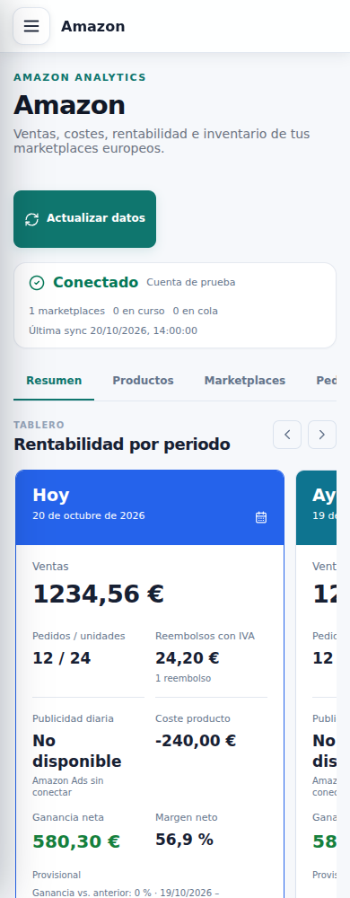 | 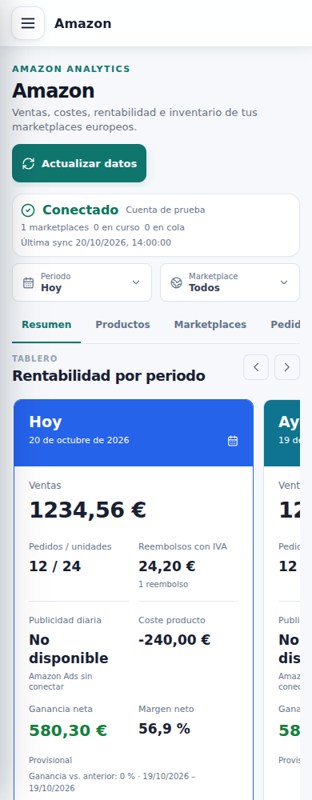 |
| Amazon | 1280 | 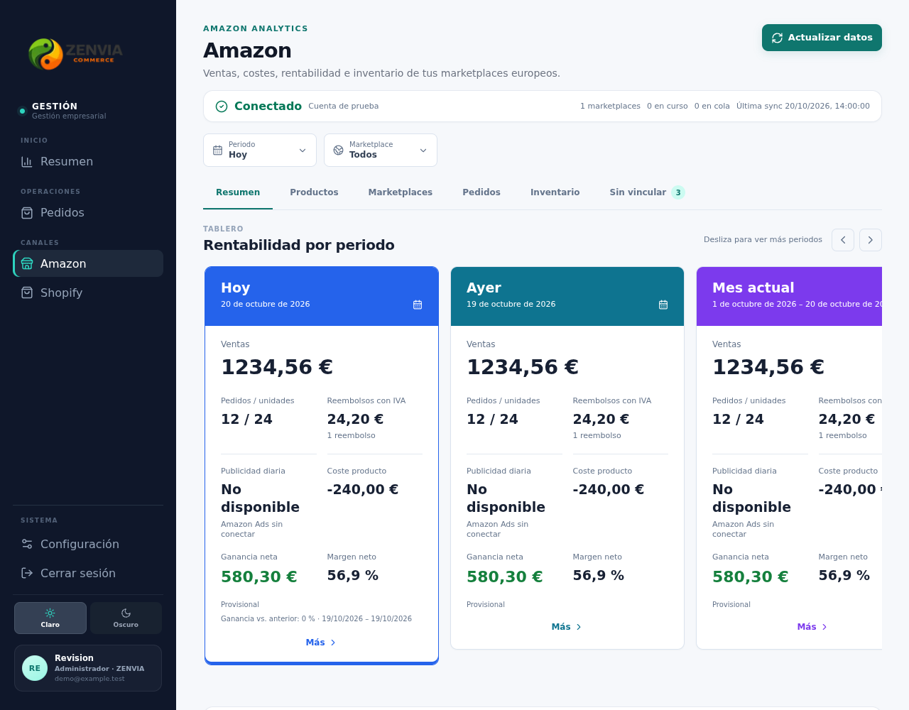 | 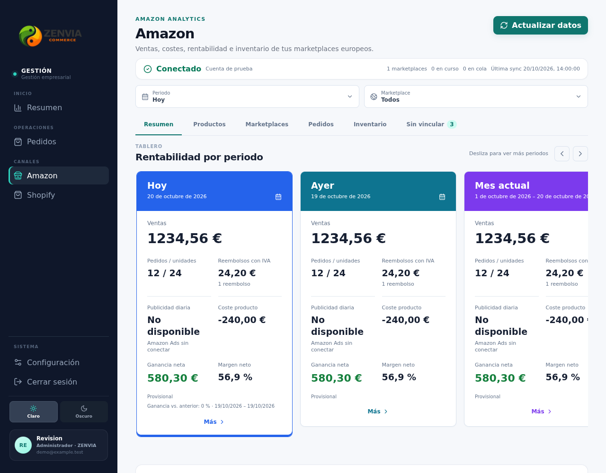 |
| Amazon | 1440 | 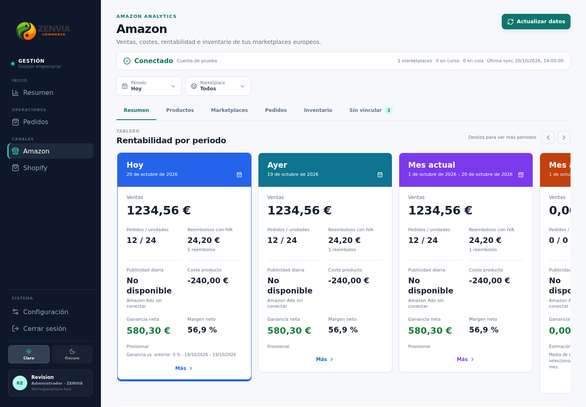 | 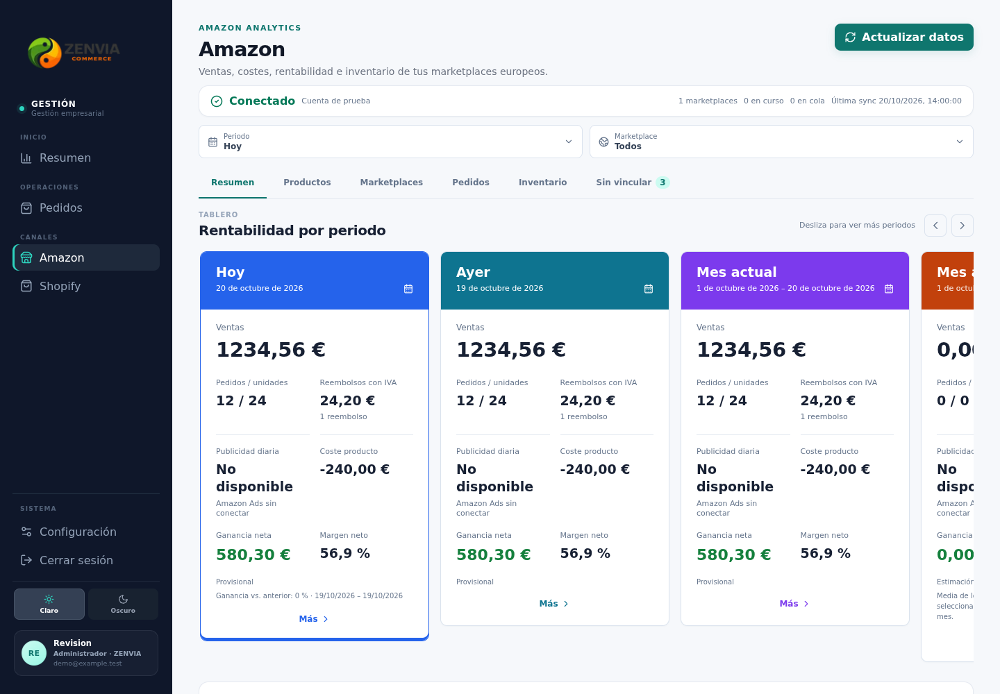 |
| Shopify | 390 | 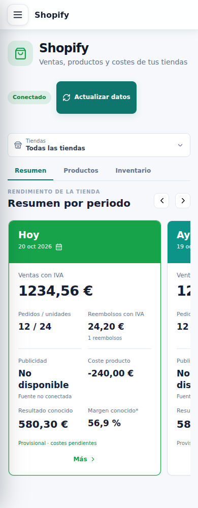 | 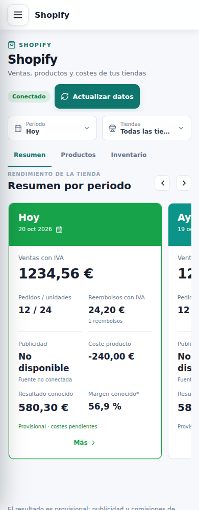 |
| Shopify | 1280 |  | 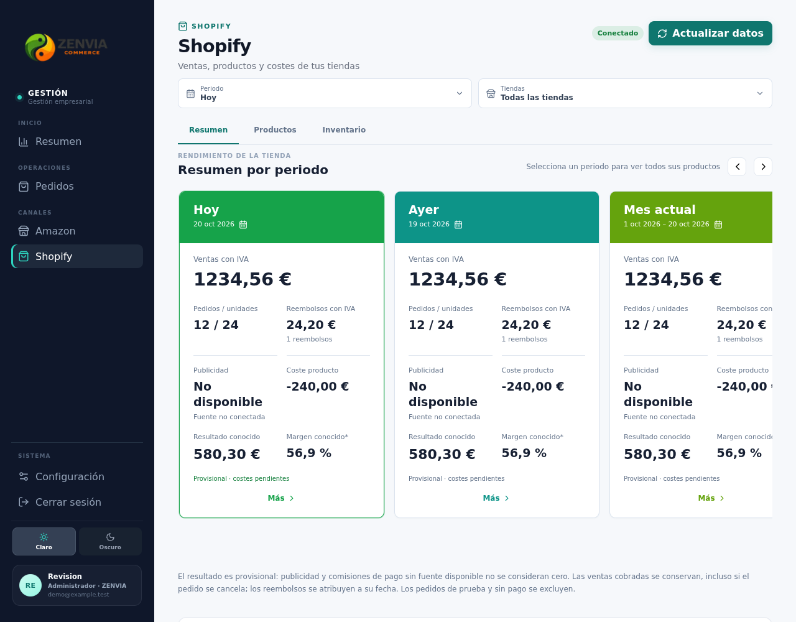 |
| Shopify | 1440 | 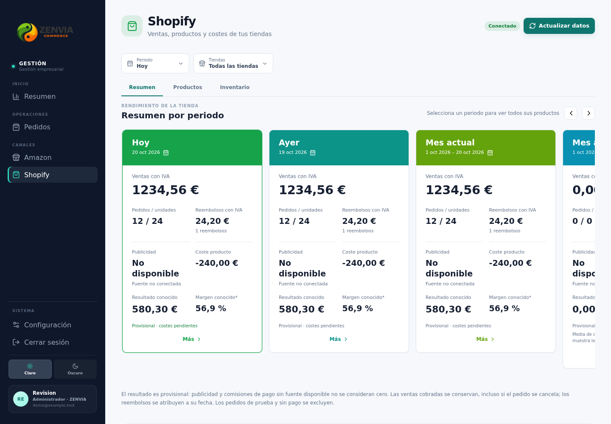 | 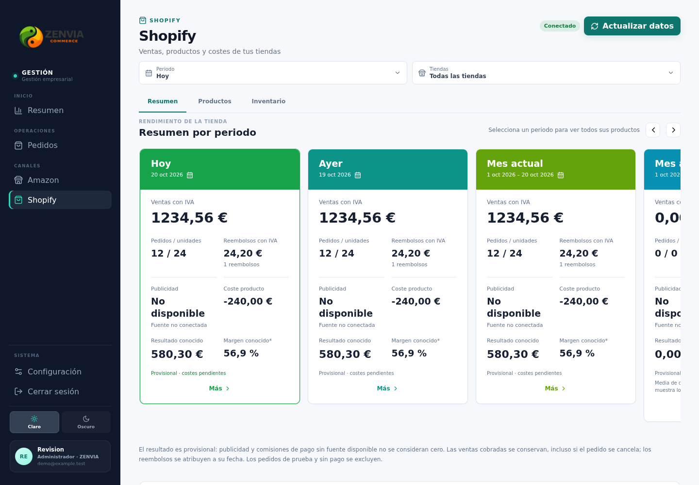 |

## Altura hasta el primer producto en Resumen

| Pantalla | Ancho | Antes (px) | Después (px) | Pantallazos después |
|---|---:|---:|---:|---:|
| Amazon | 390 | 1317.9 | 1287.3 | 1.29 |
| Amazon | 1280 | 1135.6 | 1122.6 | 1.12 |
| Amazon | 1440 | 1121.6 | 1108.6 | 1.11 |
| Shopify | 390 | 1353.5 | 1269.7 | 1.27 |
| Shopify | 1280 | 1125.1 | 1118.1 | 1.12 |
| Shopify | 1440 | 1125.1 | 1118.1 | 1.12 |

## Pestaña Productos

| Pantalla | Ancho | Antes (px) | Después (px) |
|---|---:|---:|---:|
| Amazon | 390 | [731.5](before-amazon-products-390.png) | [692.9](after-amazon-products-390.png) |
| Amazon | 1280 | [499.5](before-amazon-products-1280.png) | [482.5](after-amazon-products-1280.png) |
| Amazon | 1440 | [485.5](before-amazon-products-1440.png) | [468.5](after-amazon-products-1440.png) |
| Shopify | 390 | [708.5](before-shopify-products-390.png) | [632.7](after-shopify-products-390.png) |
| Shopify | 1280 | [471.3](before-shopify-products-1280.png) | [468.3](after-shopify-products-1280.png) |
| Shopify | 1440 | [471.3](before-shopify-products-1440.png) | [468.3](after-shopify-products-1440.png) |

Se incluyen segundos pantallazos móviles. Se recorren las cinco tarjetas para cargar cada periodo antes de comparar; la captura vuelve a Hoy. Se compara texto íntegro de todas las tarjetas, variantes positivas/negativas y sus botones, cifras de la fila, tabs y acciones de cabecera. Filtros de igual ancho/altura y texto en una línea. No se convierten los carruseles a KpiGrid: conservan su interacción y sus métricas por periodo.

La prueba offline comprueba eventos de Shopify (tarjetas y productos, búsqueda conservada), recuperación de Amazon al volver online y el callback manual de Actualizar datos en ambas pantallas, siempre contra servicios sintéticos. Las pruebas reales del watcher conservan respaldo visible de 25 s; no se consulta ninguna tienda ni se generan pedidos. `source-parity.json` registra hashes de componentes/servicios analíticos intactos y comparación exacta de hooks/callbacks de ambas páginas.

La paginación, los datos, las tablas, las vinculaciones de productos, los estados provisionales/sin fuente y las reglas de ventas cobradas permanecen en sus propietarios actuales. No se afirman mejoras de escala ni verificación visual autenticada en producción.
