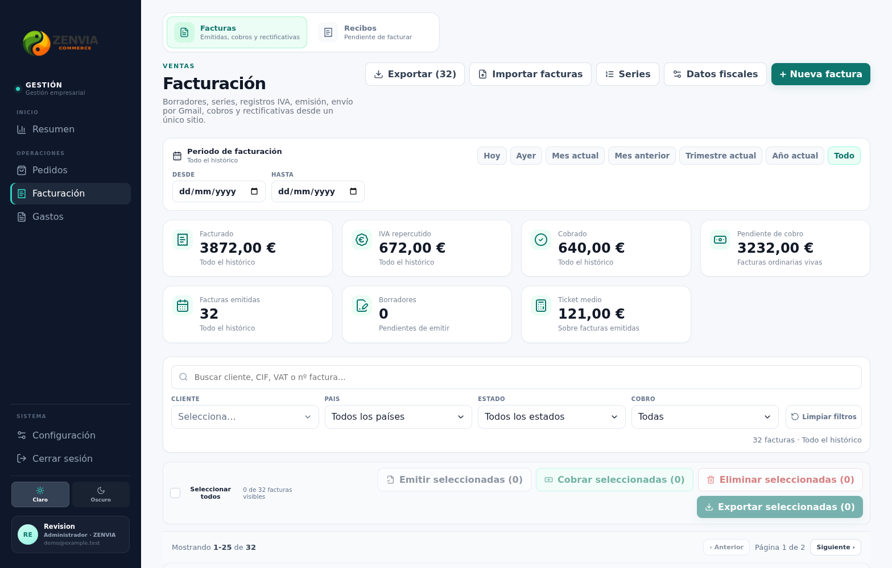
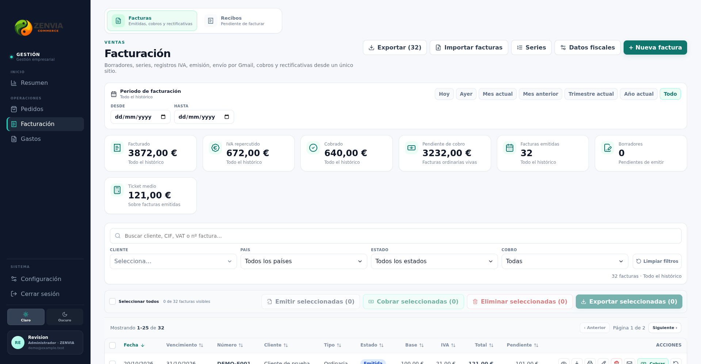
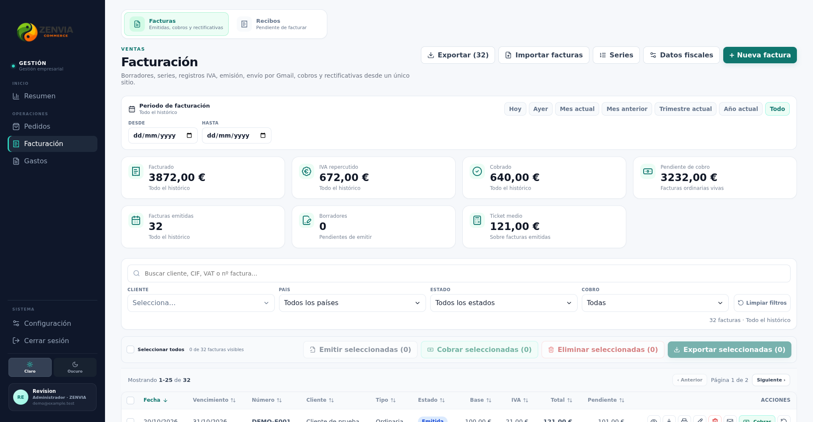
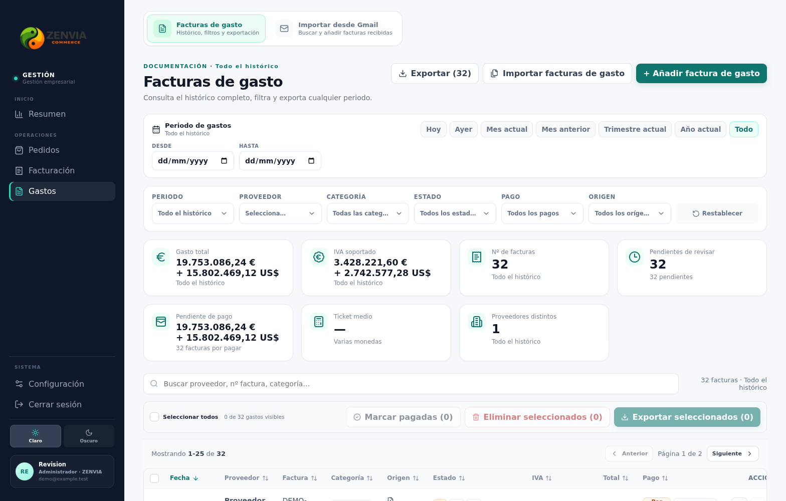
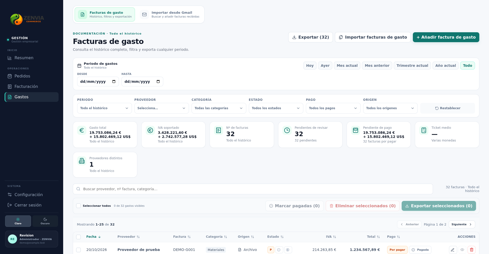
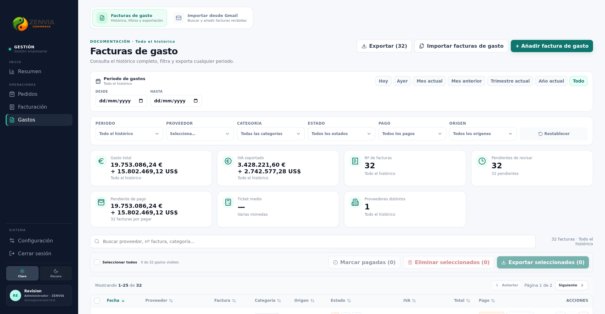
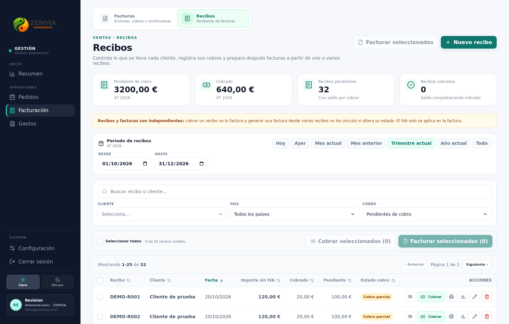
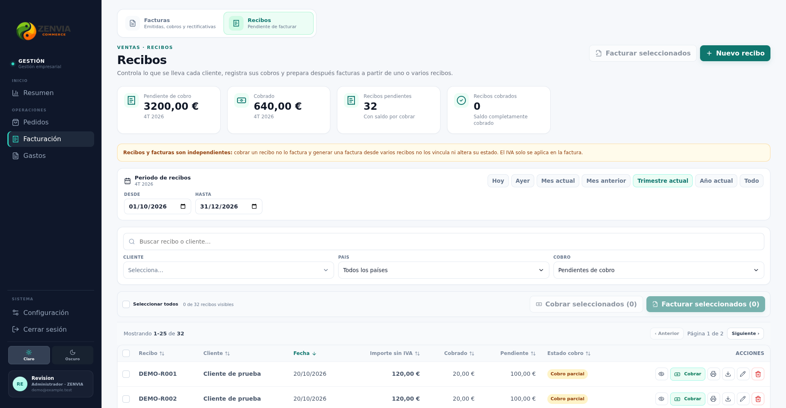
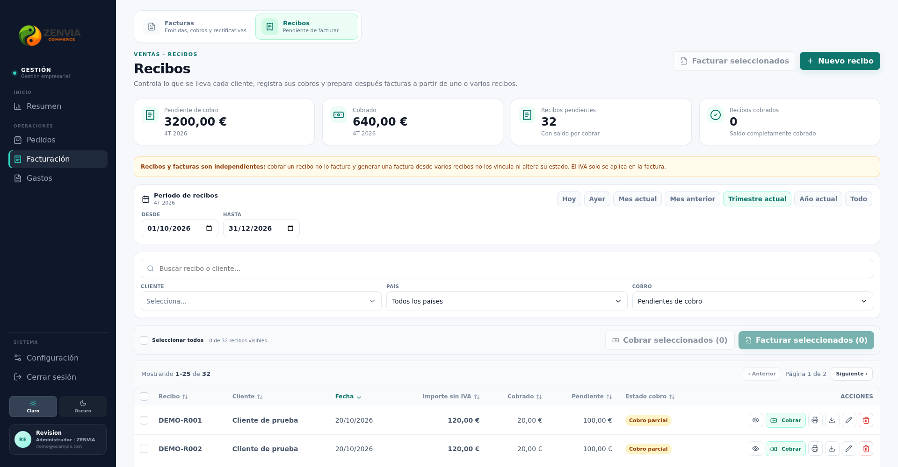

# Equilibrio de KPI · referencia fase 2

Componentes reales Facturación/Gastos/Recibos, a 1568 y 1920 px; caso de siete KPI y capacidad amplia de seis columnas. Misma información, filtros, acciones y datos sintéticos.

| Pantalla | Ancho | Columnas antes | Columnas después | Antes | Después |
|---|---:|---:|---:|---|---|
| billing | 1568 | 4 | 4 |  |  |
| billing | 1920 | 6 | 4 |  |  |
| expenses | 1568 | 4 | 4 |  |  |
| expenses | 1920 | 6 | 4 |  |  |
| receipts | 1568 | 4 | 4 |  |  |
| receipts | 1920 | 6 | 4 |  |  |

Siete KPI pasan de 6 + 1 a 4 + 3 en el breakpoint amplio. A 1568 CSS px el harness de referencia ya calculaba cuatro columnas; no se inventa una reproducción de seis columnas en ese ancho. La prueba añade 1920 px para reproducir la capacidad de seis y cubre el caso comunicado por el propietario. Rejillas compartidas: el algoritmo se aplica a todas las pantallas migradas. En móvil se mantienen exactamente dos columnas aunque un total impar deje el último elemento en su propia fila; no se expande a todo el ancho.
